University: [ITMO University](https://itmo.ru/ru/)
Faculty: [FICT](https://fict.itmo.ru)
Course: [Cloud platforms as the basis of technology entrepreneurship](https://github.com/itmo-ict-faculty/cloud-platforms-as-the-basis-of-technology-entrepreneurship)
Year: 2026/2027
Group: U4225
Author: Matsukov Artem Sergeevich
Lab: Lab1
Date of create: 04.11.2026
Date of finished:

# Лабораторная работа №1. Обзор Google Cloud и исследование основных сервисов

## Цель

Ознакомиться с основными возможностями и преимуществами облачной платформы Google Cloud: управление доступом через IAM, виртуальная машина Compute Engine и чтение объектов из Cloud Storage.

## Ход работы

Имена ресурсов:

- service account: `amatsukov-sa-lab1`
- виртуальная машина: `matsukov-a-s-vm-lab1`
- проект: `cloud-platforms-as-the-basis`
- учебный бакет: `lab1-bucket-itmo`

### 1. Доступ к проекту

Почта для заявки: `matsukovartem03@gmail.com`. Доступ выдан в проект `cloud-platforms-as-the-basis`.

### 2. Service account с ролью Storage Admin

Создан сервисный аккаунт `amatsukov-sa-lab1` и привязан к виртуальной машине. Адрес: `amatsukov-sa-lab1@cloud-platforms-as-the-basis.iam.gserviceaccount.com`. Область доступа: **Allow full access to all Cloud APIs**. Роль на момент копирования файлов — **Storage Admin**.

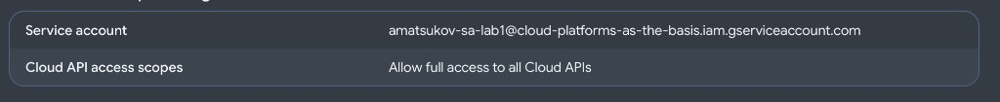

На самой машине metadata server возвращает тот же адрес. Команда выполнена из SSH под пользователем `matsukovartem03`:

```bash
curl -s -H "Metadata-Flavor: Google" \
  http://metadata.google.internal/computeMetadata/v1/instance/service-accounts/default/email
```

```text
amatsukov-sa-lab1@cloud-platforms-as-the-basis.iam.gserviceaccount.com
```

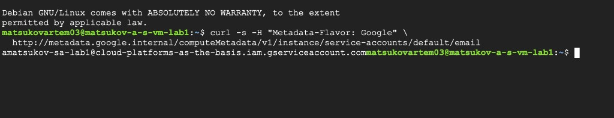

### 3. Виртуальная машина e2-micro в режиме Spot

Экземпляр `matsukov-a-s-vm-lab1` создан 4 ноября 2026 года, зона `us-central1-c`, образ `debian-13-trixie-v20261027`. Тип машины `e2-micro` (2 vCPU, 1 GB). Режим подготовки — **Spot**, статус после создания — **Running**.

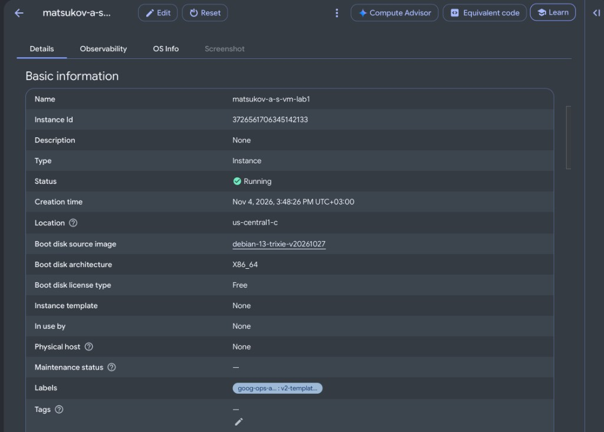

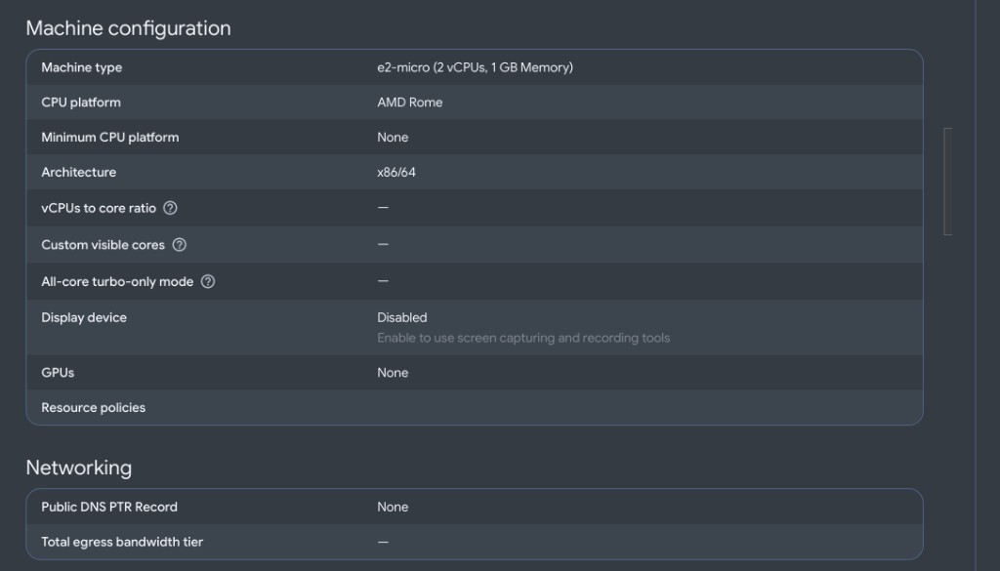

### 4. Копирование трёх файлов из бакета на VM

Бакет найден утилитой `gcloud` от сервисного аккаунта с ролью **Storage Admin**. В корне три объекта:

```bash
gcloud config set project cloud-platforms-as-the-basis
gcloud storage ls gs://lab1-bucket-itmo
```

```text
gs://lab1-bucket-itmo/pic1.jpg
gs://lab1-bucket-itmo/pic2.jpg
gs://lab1-bucket-itmo/pic3.jpeg
```

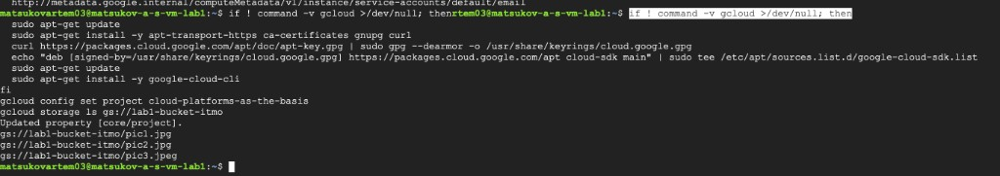

С ролью **Storage Admin** копирование трёх объектов в `/home/matsukovartem03/lab1-files` завершилось успешно, `3/3`, суммарно 1.5 MiB:

```bash
mkdir -p ~/lab1-files
gcloud storage cp \
  gs://lab1-bucket-itmo/pic1.jpg \
  gs://lab1-bucket-itmo/pic2.jpg \
  gs://lab1-bucket-itmo/pic3.jpeg \
  ~/lab1-files/
ls -lah ~/lab1-files
```

```text
total 1.6M
-rw-rw-r-- 1 matsukovartem03 matsukovartem03 228K Nov  4 12:59 pic1.jpg
-rw-rw-r-- 1 matsukovartem03 matsukovartem03 487K Nov  4 12:59 pic2.jpg
-rw-rw-r-- 1 matsukovartem03 matsukovartem03 858K Nov  4 12:59 pic3.jpeg
```

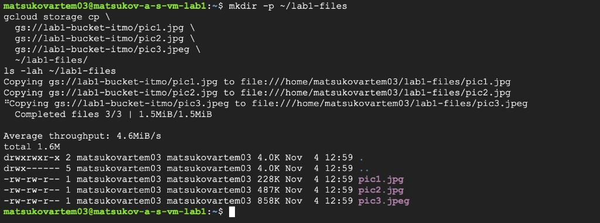

### 5. Смена роли на Compute Viewer и повторное копирование

В **IAM & Admin → IAM** у `amatsukov-sa-lab1@cloud-platforms-as-the-basis.iam.gserviceaccount.com` роль **Storage Admin** заменена на **Compute Viewer**.

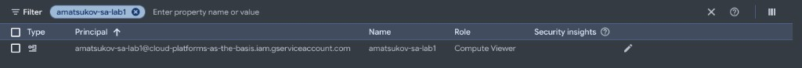

Сразу после сохранения повторное копирование в `~/lab1-files-2` снова завершилось успешно, `3/3`, 1.5 MiB. Ошибки 403 в этот момент не было.

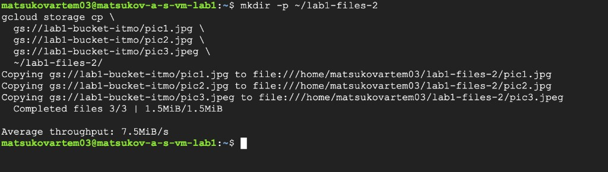

Повторная проверка в том же SSH. Активный аккаунт `gcloud` — по-прежнему сервисный аккаунт, не личный Gmail:

```text
ACTIVE  ACCOUNT
*       amatsukov-sa-lab1@cloud-platforms-as-the-basis.iam.gserviceaccount.com
```

Анонимный запрос к объекту возвращает HTTP 200, поэтому копирование конкретного файла снова проходит. Чтение IAM-политики бакета уже запрещено: у **Compute Viewer** нет права `storage.buckets.getIamPolicy`.

```bash
curl -s -o /dev/null -w "public_http_code=%{http_code}\n" \
  https://storage.googleapis.com/lab1-bucket-itmo/pic1.jpg
gcloud storage cp gs://lab1-bucket-itmo/pic1.jpg ~/lab1-files-3/
gcloud storage buckets get-iam-policy gs://lab1-bucket-itmo
```

```text
public_http_code=200
Completed files 1/1 | 227.8KiB/227.8KiB

ERROR: (gcloud.storage.buckets.get-iam-policy) Permission 'storage.buckets.getIamPolicy' denied
on resource gs://lab1-bucket-itmo.
Authenticated as amatsukov-sa-lab1@cloud-platforms-as-the-basis.iam.gserviceaccount.com.
```

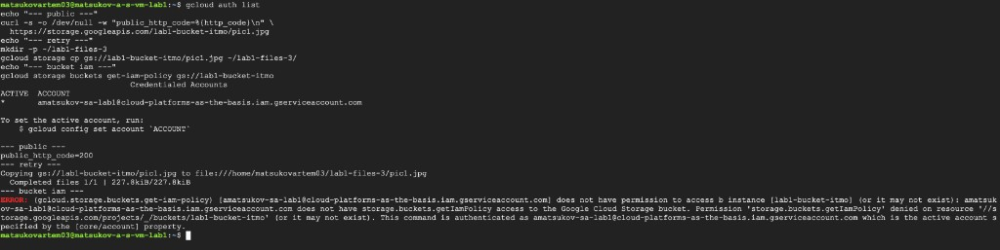

Список объектов после смены роли тоже открывается:

```bash
gcloud storage ls gs://lab1-bucket-itmo
```

```text
gs://lab1-bucket-itmo/pic1.jpg
gs://lab1-bucket-itmo/pic2.jpg
gs://lab1-bucket-itmo/pic3.jpeg
```

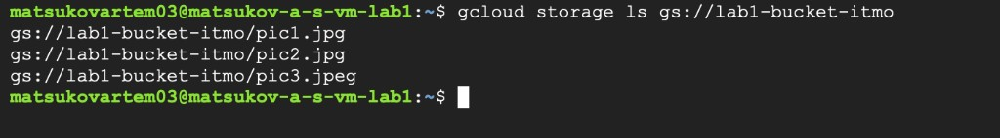

### 6. Удаление созданных сервисов

Экземпляр `matsukov-a-s-vm-lab1` удалён. В **Compute Engine → VM instances** список пуст. Учебный бакет `lab1-bucket-itmo` не удалялся: он общий для курса.

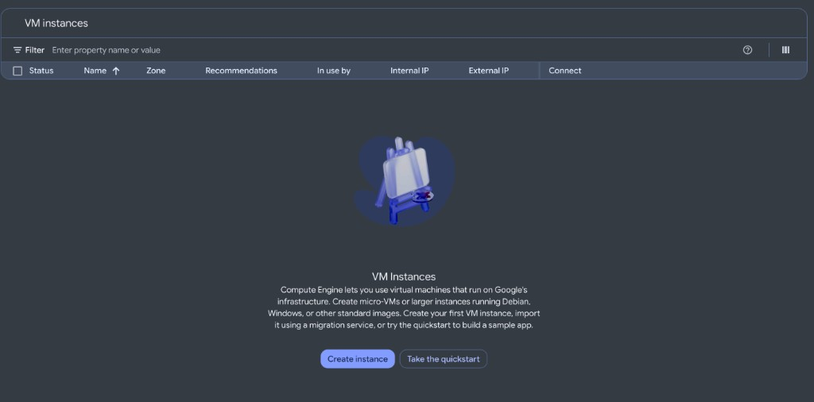

Сервисный аккаунт `amatsukov-sa-lab1` удалён: в **IAM & Admin → Service accounts** его больше нет. Общий список аккаунтов проекта в отчёт не вставлялся, потому что в нём видны учётные записи других студентов.

## Выводы

Роль **Storage Admin** на проекте даёт сервисному аккаунту управление Cloud Storage. С ней `amatsukov-sa-lab1` нашёл бакет `lab1-bucket-itmo` и скопировал `pic1.jpg`, `pic2.jpg` и `pic3.jpeg` на Spot VM `matsukov-a-s-vm-lab1`.

После замены роли на **Compute Viewer** аккаунт тот же, но административное действие уже запрещено: `storage.buckets.getIamPolicy` возвращает 403. **Compute Viewer** позволяет читать ресурсы Compute Engine и не включает права Cloud Storage.

Повторное копирование и повторный `gcloud storage ls` при этом успешны: снова видны `pic1.jpg`, `pic2.jpg` и `pic3.jpeg`. Причина не в задержке IAM. Объект отдаётся без аутентификации, анонимный запрос `https://storage.googleapis.com/lab1-bucket-itmo/pic1.jpg` возвращает HTTP 200. Для чтения такого объекта и списка публичного бакета роль **Storage Admin** не требуется.

Итог: проектная роль сервисного аккаунта и публичный доступ к объектам — разные механизмы. Смена **Storage Admin** на **Compute Viewer** отзывает управление бакетом, но не закрывает уже открытые файлы.
