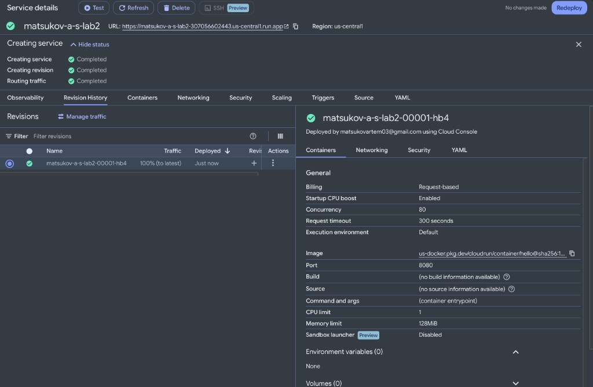
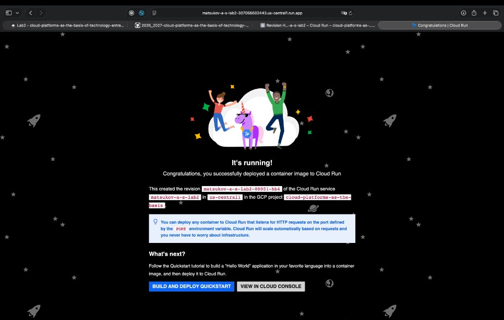
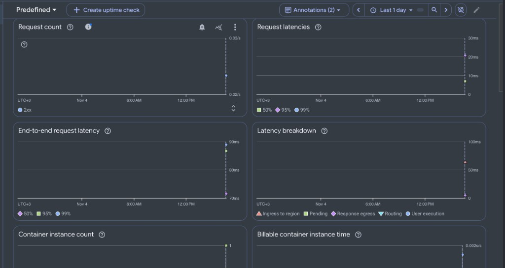
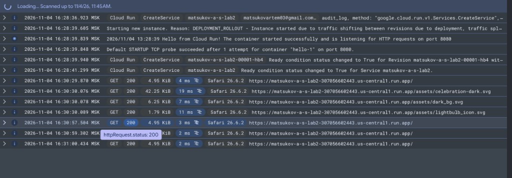
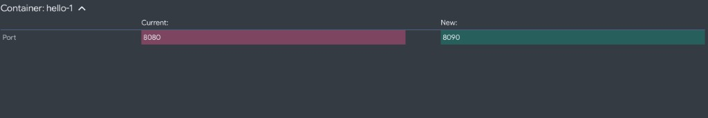
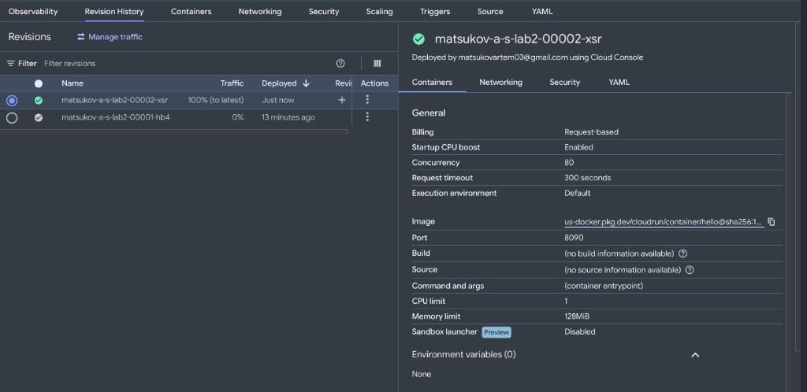
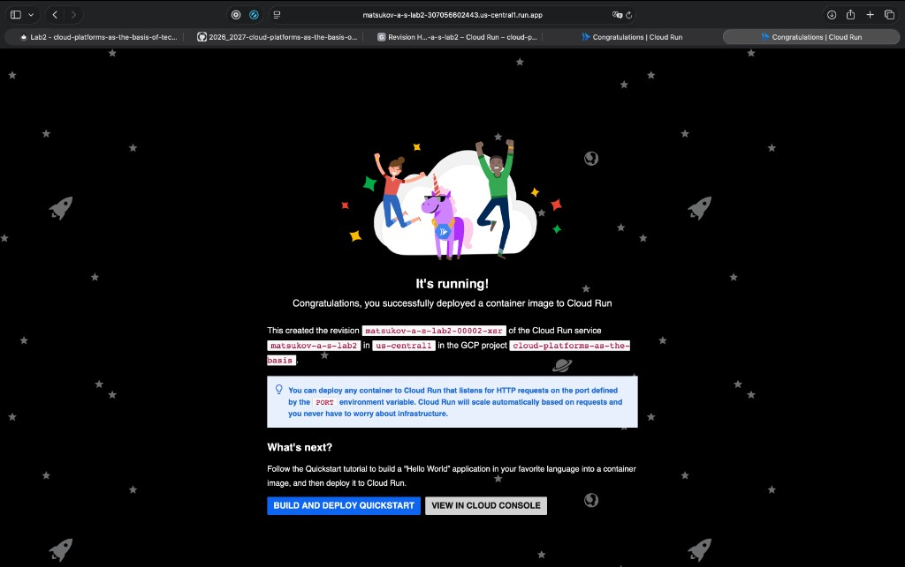
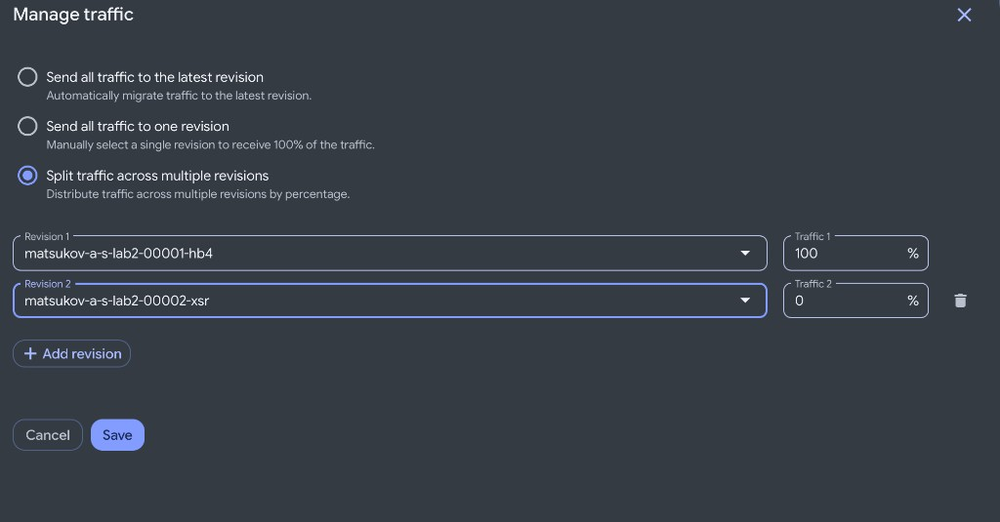
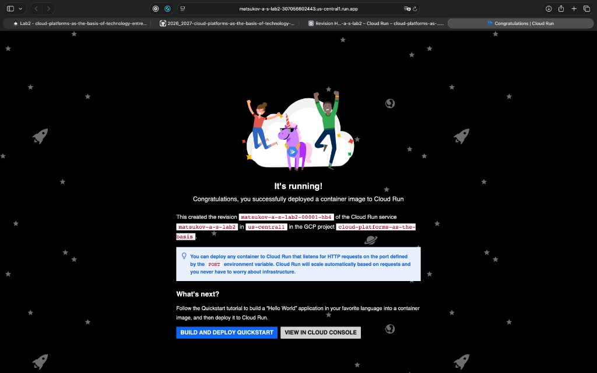
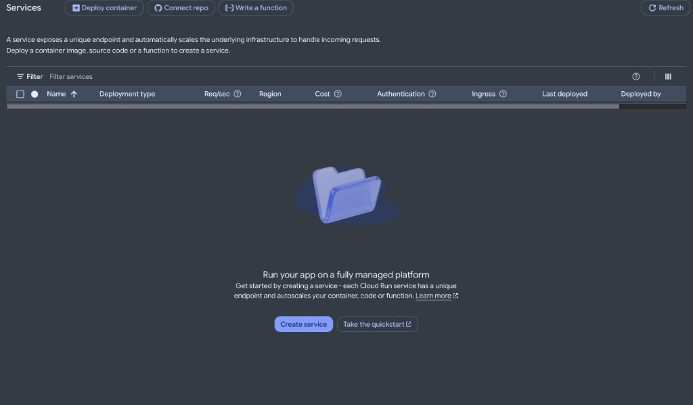

University: [ITMO University](https://itmo.ru/ru/)
Faculty: [FICT](https://fict.itmo.ru)
Course: [Cloud platforms as the basis of technology entrepreneurship](https://github.com/itmo-ict-faculty/cloud-platforms-as-the-basis-of-technology-entrepreneurship)
Year: 2026/2027
Group: U4225
Author: Matsukov Artem Sergeevich
Lab: Lab2
Date of create: 04.11.2026
Date of finished:

# Лабораторная работа №2. Исследование Cloud Run

## Цель

Ознакомиться с работой Cloud Run: запуск контейнера без своей виртуальной машины, публичный адрес, логи, метрики и переключение трафика между ревизиями.

## Ход работы

Имя сервиса: `matsukov-a-s-lab2`. Проект: `cloud-platforms-as-the-basis`. Своего приложения нет, используется учебный контейнер Hello.

### 1. Сервис Hello с минимальными ресурсами

Сервис `matsukov-a-s-lab2` создан в регионе `us-central1` из образа `us-docker.pkg.dev/cloudrun/container/hello`. Первая ревизия — `matsukov-a-s-lab2-00001-hb4`, на неё направлен весь трафик. Порт контейнера `8080`, лимит CPU `1`, память `128 MiB`, оплата **Request-based**: ресурсы считаются только пока обрабатывается запрос. Минимум экземпляров оставлен нулевым, поэтому без посетителей сервис засыпает.

### 2. Проверка сервиса по ссылке

Публичный адрес `https://matsukov-a-s-lab2-307056602443.us-central1.run.app` открывается без входа в Google. Страница показывает **It's running!** и подтверждает ревизию `matsukov-a-s-lab2-00001-hb4`, сервис `matsukov-a-s-lab2`, регион `us-central1` и проект `cloud-platforms-as-the-basis`.

### 3. Логи и метрики

На вкладке **Observability** за последний день виден один всплеск около 16:30. **Request count** показывает ответы `2xx`. Задержка самого Cloud Run около 10–20 мс, сквозная задержка до браузера около 70–90 мс. В разбивке основное время занимает выполнение контейнера, очередь почти нулевая. **Container instance count** поднимается до 1, а **Billable container instance time** даёт короткий всплеск: оплата request-based считает только время обработки запросов.

В логах в 16:28:36 сервис создан пользователем `matsukovartem03@gmail.com`. Контейнер `hello-1` стартовал с первой попытки и пишет: `listening for HTTP requests on port 8080`. Ревизия `matsukov-a-s-lab2-00001-hb4` перешла в состояние Ready. Дальше идут запросы браузера Safari: `GET 200` на `/` и на картинки страницы, время ответа 2–19 мс.

### 4. Порт 8090 и переключение трафика

Новая ревизия собрана из того же образа Hello. Изменился только порт контейнера: `8080` → `8090`.

Ревизия `matsukov-a-s-lab2-00002-xsr` стала зелёной и получила 100% трафика. Предыдущая `matsukov-a-s-lab2-00001-hb4` осталась в списке с 0%. В карточке новой ревизии порт указан как `8090`.

Публичный адрес не изменился. Страница снова показывает **It's running!**, но в тексте уже ревизия `matsukov-a-s-lab2-00002-xsr`. Контейнер Hello слушает порт из переменной `PORT`, а Cloud Run подставляет туда значение из настройки. Поэтому смена 8080 на 8090 не сломала сервис.

Затем в **Manage traffic** выбран режим **Split traffic across multiple revisions**: 100% на `matsukov-a-s-lab2-00001-hb4` и 0% на `matsukov-a-s-lab2-00002-xsr`.

После сохранения тот же адрес `https://matsukov-a-s-lab2-307056602443.us-central1.run.app` показывает уже первую ревизию. Картинка и адрес прежние, в тексте страницы изменилось только имя ревизии.

### 5. Удаление сервиса

Сервис `matsukov-a-s-lab2` удалён вместе с обеими ревизиями. В **Cloud Run → Services** список пуст. Образ Hello принадлежит Google, отдельный репозиторий в Artifact Registry для этой работы не создавался.

## Выводы

Cloud Run запускает контейнер и выдаёт ему постоянный HTTPS-адрес. Свою виртуальную машину для этого держать не нужно. При нуле посетителей экземпляр засыпает, а оплата **Request-based** считает короткое время обработки запроса. Это видно на метриках: один экземпляр и маленький всплеск billable time. В логах старт и ответы `GET 200` относятся к конкретной ревизии.

Смена порта с `8080` на `8090` создала вторую ревизию и не сломала сайт. Образ Hello слушает порт из переменной `PORT`, а Cloud Run записывает в неё значение из настройки сервиса. Для посетителя адрес остаётся прежним: снаружи всегда обычный HTTPS, а выбранный порт используется только внутри.

Переключение трафика выбирает, какая ревизия отвечает на этот адрес. При 100% на `00002-xsr` страница называла вторую ревизию, при 100% на `00001-hb4` — первую. Содержимое страницы не изменилось, потому что обе ревизии собраны из одного образа. Так можно выложить новую версию и вернуть пользователей на старую, не меняя ссылку.
