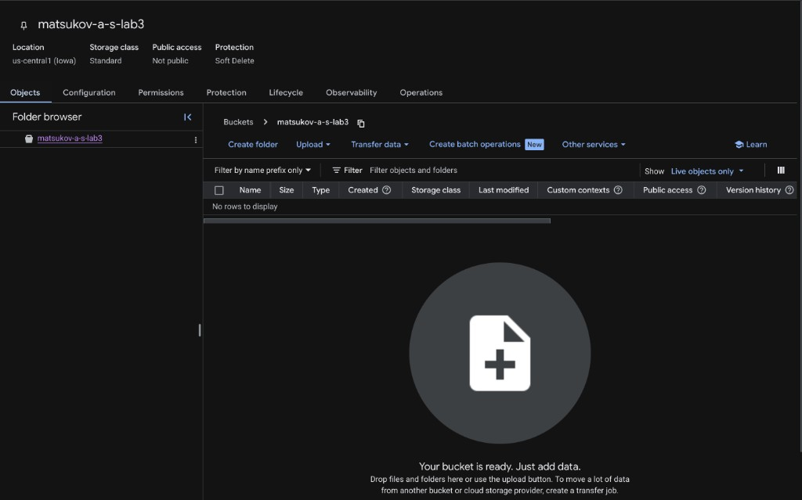
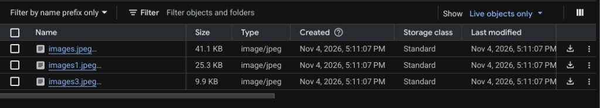
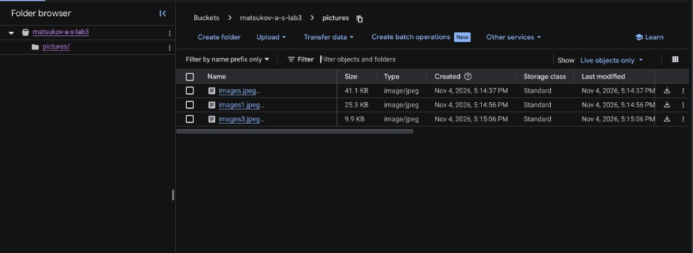
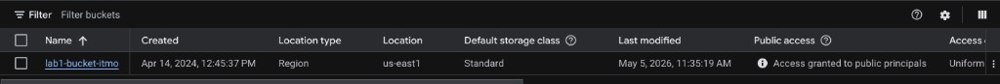

University: [ITMO University](https://itmo.ru/ru/)
Faculty: [FICT](https://fict.itmo.ru)
Course: [Cloud platforms as the basis of technology entrepreneurship](https://github.com/itmo-ict-faculty/cloud-platforms-as-the-basis-of-technology-entrepreneurship)
Year: 2026/2027
Group: U4225
Author: Matsukov Artem Sergeevich
Lab: Lab3
Date of create: 04.11.2026
Date of finished:

# Лабораторная работа №3. Исследование Cloud Storage

## Цель

Ознакомиться с объектным хранилищем Cloud Storage: бакет, загрузка файлов, папки как префиксы имён, публичный доступ и ссылка на объект.

## Ход работы

Проект: `cloud-platforms-as-the-basis`. Бакет: `matsukov-a-s-lab3`.

### 1. Создание бакета

В проекте `cloud-platforms-as-the-basis` создан бакет `matsukov-a-s-lab3`. Регион `us-central1` (Iowa), класс хранения **Standard**, доступ **Not public**, защита **Soft Delete**. Список объектов пуст.

### 2. Загрузка изображений

В корень бакета загружены три файла `image/jpeg`: `images.jpeg` (41.1 KB), `images1.jpeg` (25.3 KB) и `images3.jpeg` (9.9 KB). Класс хранения у всех **Standard**.

### 3. Папка и перенос файлов

В бакете создана папка `pictures`. Три изображения перенесены из корня в неё. В объектном хранилище папка — это префикс имени: полный путь объекта выглядит как `pictures/images.jpeg`.

### 4. Публичный доступ и ссылка

На бакете `matsukov-a-s-lab3` субъекту `allUsers` выдана роль **Storage Object Viewer**. Любой человек может читать объекты, но не изменять бакет. В отчёт попала только эта строка: на полном снимке прав видны учётные записи других участников проекта.

Через меню файла скопирована публичная ссылка. Она открывается без входа в Google и отдаёт само изображение:

`https://storage.googleapis.com/matsukov-a-s-lab3/pictures/images.jpeg`

### 5. Удаление бакета

Бакет `matsukov-a-s-lab3` удалён вместе с папкой `pictures` и публичным доступом. В списке бакетов проекта остался только общий учебный `lab1-bucket-itmo`.

## Выводы

Cloud Storage хранит файлы как объекты в бакете, а не как диск, подключённый к компьютеру. Папка `pictures` не является отдельным контейнером: это префикс в имени объекта, поэтому после переноса путь стал `pictures/images.jpeg`.

Публичность задаётся правом, а не форматом картинки. Роль **Storage Object Viewer** для `allUsers` разрешает чтение всем. Ссылка вида `https://storage.googleapis.com/...` открывает файл без аккаунта Google. Пока это право включено, объект доступен любому, кто знает адрес, поэтому учебный бакет после работы удаляется.
