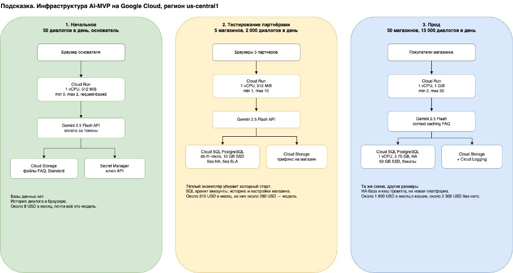

University: [ITMO University](https://itmo.ru/ru/)
Faculty: [FICT](https://fict.itmo.ru)
Course: [Cloud platforms as the basis of technology entrepreneurship](https://github.com/itmo-ict-faculty/cloud-platforms-as-the-basis-of-technology-entrepreneurship)
Year: 2026/2027
Group: U4225
Author: Matsukov Artem Sergeevich
Lab: Lab4
Date of create: 04.11.2026
Date of finished:

# Лабораторная работа №4. Инфраструктура MVP AI-приложения

## Цель

Собрать схему инфраструктуры прототипа AI-приложения, посчитать расходы на трёх стадиях и объяснить, почему дешёвый старт не должен ломать более поздние стадии.

## Исходный сценарий

В тексте задания нет числовой постановки. Для расчёта взят один конкретный продукт, чтобы нагрузки и цены можно было проверить.

Продукт называется «Подсказка». Это чат для интернет-магазина: покупатель задаёт вопрос, сервис находит фрагмент в загруженных правилах магазина и отвечает через модель Gemini. Свою модель не обучаем и не держим на видеокарте.

Регион на всех стадиях один: `us-central1`. Схема для diagrams.net: [infrastructure.drawio](infrastructure.drawio).

Общие допущения на один ответ модели:

- 1 500 входных токенов, из них большая часть — кусок FAQ;
- 300 выходных токенов;
- один диалог — 4 таких ответа;
- цены сняты с публичных прайсов на 4 ноября 2026 года.

| Ресурс | Цена |
| --- | --- |
| Gemini 2.5 Flash, вход | 0,30 USD за 1 млн токенов |
| Gemini 2.5 Flash, выход | 2,50 USD за 1 млн токенов |
| Context caching, вход текста | 0,03 USD за 1 млн токенов |
| Cloud Run, request-based, CPU в работе | 0,000024 USD за vCPU-секунду |
| Cloud Run, CPU простаивающего min-экземпляра | 0,0000025 USD за vCPU-секунду |
| Cloud Run, память | 0,0000025 USD за GiB-секунду |
| Cloud Run, запросы сверх 2 млн | 0,40 USD за 1 млн |
| Cloud SQL `db-f1-micro` | 0,0105 USD в час |
| Cloud SQL, 1 vCPU dedicated | 0,0413 USD в час |
| Cloud SQL, память | 0,007 USD за GiB-час |
| Cloud SQL SSD | 0,000232877 USD за GiB-час |
| Cloud Storage Standard | около 0,02 USD за ГБ в месяц |

Бесплатный уровень Cloud Run для request-based: 180 000 vCPU-секунд, 360 000 GiB-секунд и 2 млн запросов в месяц. Месяц для всегда включённой машины принят за 730 часов.

## Три состояния

### 1. Начальное

Нагрузка: основатель и один тестовый магазин, 50 диалогов в день. Это 6 000 ответов модели в месяц.

Состав:

- Cloud Run, 1 vCPU и 512 MiB, минимум экземпляров 0, максимум 2, оплата request-based;
- Cloud Storage для файлов FAQ;
- Secret Manager для ключа Gemini;
- отдельной базы нет, история диалога остаётся в браузере.

Почему так. На этой стадии сервис большую часть суток молчит. Виртуальная машина и видеокарта брали бы деньги круглосуточно. Cloud Run при нуле экземпляров засыпает, это уже проверено во второй лабораторной. Своя модель на GPU для 6 000 коротких ответов дороже API на порядки: в документации Cloud Run даже небольшой GPU-сервис оценивается в сотни долларов в месяц.

Расчёт модели:

- вход: 6 000 × 1 500 = 9 млн токенов × 0,30 USD = 2,70 USD;
- выход: 6 000 × 300 = 1,8 млн токенов × 2,50 USD = 4,50 USD.

Cloud Run: 6 000 запросов по 2 секунды дают 12 000 vCPU-секунд и 6 000 GiB-секунд. Оба числа внутри бесплатного уровня, запросы тоже. Storage на долях гигабайта и Secret Manager в пределах бесплатного уровня.

Итого около **8 USD в месяц**, и почти вся сумма — это модель.

### 2. Тестирование партнёрами

Нагрузка: 5 магазинов, 2 000 диалогов в день, 240 000 ответов модели в месяц.

Что меняется, а не заменяется:

- у Cloud Run минимум экземпляров становится 1, максимум 10. Партнёр не должен ждать холодный старт;
- появляется Cloud SQL PostgreSQL `db-f1-micro`, 10 GB SSD, без регионального дубля. Нужны аккаунты магазинов, история и отдельные настройки. У shared-core нет SLA, для пилота это приемлемо;
- в Cloud Storage у каждого магазина свой префикс, по тому же принципу, что папка `pictures` в третьей лабораторной.

Почему не оставить схему первой стадии. Без базы нельзя отделить данные магазинов и показать партнёру прошлые диалоги. Почему не брать сразу HA и не поднимать GKE: пилот ещё может пережить короткую недоступность базы, а кластер Kubernetes добавит работу, которой некому заниматься.

Расчёт модели:

- вход: 240 000 × 1 500 = 360 млн токенов × 0,30 USD = 108 USD;
- выход: 240 000 × 300 = 72 млн токенов × 2,50 USD = 180 USD;
- модель: **288 USD**.

Cloud Run, верхняя оценка при одном запросе на экземпляр и 2 секундах работы. Активных секунд 480 000, остальные секунды месяца один экземпляр простаивает:

- CPU: 480 000 × 0,000024 + 2 148 000 × 0,0000025 = 16,89 USD;
- память 512 MiB: половина от 480 000 × 0,0000025 + 2 148 000 × 0,0000025 = 3,29 USD;
- бесплатный уровень снимает примерно 5 USD;
- запросы не тарифицируются, их меньше 2 млн.

Cloud Run около **15 USD**. При реальной одновременной обработке нескольких запросов сумма будет меньше.

Cloud SQL:

- машина: 0,0105 × 730 = 7,67 USD;
- 10 GB SSD: около 1,70 USD;
- бэкап того же объёма: около 0,80 USD.

База около **10 USD**. Storage по-прежнему около 1 USD.

Итого около **315 USD в месяц**. Инфраструктура стоит около 25 USD, модель — около 290 USD. Удешевлять пилот нужно более коротким промптом, а не отказом от базы.

### 3. Прод

Нагрузка: 50 магазинов, 15 000 диалогов в день, 1,8 млн ответов модели в месяц.

Что меняется:

- Cloud Run: 1 vCPU, 1 GiB, минимум 2 экземпляра, максимум 30. Два тёплых экземпляра переживают выкладку новой ревизии: трафик между ревизиями уже переключался во второй лабораторной;
- Cloud SQL переезжает с shared-core на `db-custom-1-3840` (1 vCPU, 3.75 GB) в конфигурации HA, диск 50 GB. Shared-core не даёт SLA, для оплаты покупателями это уже не подходит;
- включён context caching для повторяющегося текста FAQ;
- остаётся Cloud Logging. Отдельный балансировщик и Cloud Armor не ставятся, пока нет волны мусорных запросов: HTTPS у Cloud Run уже есть.

Расчёт модели без кеша:

- вход: 2,7 млрд токенов × 0,30 USD = 810 USD;
- выход: 540 млн токенов × 2,50 USD = 1 350 USD;
- модель: **2 160 USD**.

С кешем, если 70% входа — повторяемый FAQ по 0,03 USD за миллион:

- кешированный вход: 1,89 млрд × 0,03 USD = 57 USD;
- остальной вход: 0,81 млрд × 0,30 USD = 243 USD;
- выход тот же: 1 350 USD;
- модель: **1 650 USD**.

Cloud Run. Два экземпляра простаивают почти весь месяц, активное время короткое, потому что один экземпляр держит много запросов сразу:

- простой CPU: 2 × 2 628 000 × 0,0000025 = 13,14 USD;
- простой памяти 1 GiB: ещё 13,14 USD;
- активная работа при concurrency 20 и 1,5 секунды на запрос: около 4 USD;
- минус бесплатный уровень, итог около **25 USD**.

Cloud SQL HA:

- один vCPU и 3,75 GB без дубля: 30,15 + 19,16 = 49,31 USD, с HA compute около **99 USD**;
- региональный диск и бэкапы: оценка около **20 USD**.

Logging и Storage: около **11 USD**.

Итого с кешем около **1 800 USD в месяц**, без кеша около **2 300 USD**.

## Что сознательно не берётся

Своя модель на GPU не берётся ни на одной стадии. При цене ответа через Flash инфраструктура в проде стоит около 150 USD, а модель — больше 1 500 USD. GPU имеет смысл пересчитывать только если счёт за токены устойчиво выше стоимости карты, которая даёт нужное качество ответа. На старте такая карта была бы платой за простой.

GKE не берётся. Один сервис и одна база не требуют оркестратора.

Vector Search и отдельная векторная база не берутся. На десятках магазинов фрагменты FAQ помещаются в PostgreSQL. Отдельный поисковый кластер добавит постоянную плату раньше, чем появится объём документов.

Самое дешёвое первое состояние, ноль экземпляров и никакой базы, плохо как постоянная архитектура: партнёры упираются в холодный старт и в отсутствие общих данных. Поэтому дорожает не платформа, а два параметра: тёплые экземпляры Cloud Run и нормальная база. Код сервиса между стадиями не переписывается.

## Выводы

Для этого MVP оптимальна одна схема на всех стадиях: Cloud Run вызывает Gemini, документы лежат в Cloud Storage, секреты лежат в Secret Manager. База добавляется на второй стадии, отказоустойчивый режим базы и кеш промпта — на третьей.

На старте содержание стоит около 8 USD в месяц. У партнёров около 315 USD, и 90% этой суммы — токены, а не серверы. В проде около 1 800 USD при включённом кеше. Экономия на первой неделе за счёт видеокарты или Kubernetes не окупается: эти ресурсы пришлось бы оплачивать, когда пользователей ещё нет, и они не удешевляют главный счёт, счёт за модель.
